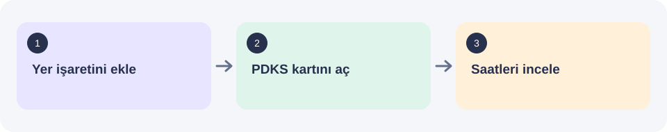

# Mesai

ARGE Portal çalışma saatlerini hesapla ve haftanı planla. / Calculate work hours and plan your week in ARGE Portal.

**Version:** [version.json](version.json) · Tarayıcı yer işareti aracı. Önizleme örnek veri kullanır; gerçek portal hesabı gerektirmez.

## Start here

[Kurulum ve örnek önizleme / Setup and sample preview](https://berkant-jotform.github.io/mesai/).

Kurulum sayfasını aç, yüklemek istediğin temayı seç ve **Hazır** yazınca **Mesai** düğmesini yer işaretleri çubuğuna sürükle. ARGE Portal’da PDKS (personel giriş-çıkış) kartını açıp yer işaretine tıkla. Önce kurulum sayfasındaki örnek önizlemeyi deneyebilirsin.

[Adım adım kullanım / Step-by-step guide](docs/GETTING_STARTED.md).

## What needs configuration

| Item | What to know |
| --- | --- |
| Kurulum / Installation | Use the linked setup page; there is no executable installer. |
| Portal erişimi / Portal access | Needed only for real records, not for the sample preview. |
| Güncelleme / Update | Drag the bookmark again after a new version; old bookmarks do not update themselves. |

## Downloads and help

- [Download and build guide](docs/DOWNLOADS.md) — source files versus packaged apps.
- [Developer reference](docs/REFERENCE.md) — workflow details and relevant limits.
- [Contributing](CONTRIBUTING.md) · [Security](SECURITY.md) · [Usage and licensing](USAGE.md).

### 3.2.5

Şövalye görünümü tek bir resimli çerçeve olarak yeniden kuruldu. Açık ve koyu görünüm aynı yerleşimi kullanır; Sor, ayarlar ve geçmiş çerçevenin içinde açılır. Hesaplama kuralları değişmedi.

### 3.2.1
Şövalye görünümü el yazması düzeniyle yeniden işlendi: çiçekli kenarlar, kale detayı, gömülü Gotik ve kaligrafik yazı tipleri. Göksel saatin iç kadranı ve rakamları yenilendi. Hesap kuralları değişmedi.

3.2.5 fixes artwork and font loading on portals that restrict image/font URLs. Bundled artwork renders to canvas and fonts load from bytes; no host policy changes are required. Restricted-policy browser fixture: `source/mesai/test/csp-preview.html`.

3.2.5 adds a visible theme menu, close controls for open panels, Escape dismissal, consistent Cep/minimize behavior and themed progress marks.

3.2.5 replaces symbolic theme swatches with real light/dark layout previews, adds a ruler-linked drafting cursor effect to the website, and credits Berkant with a Slack feedback invitation.

## 3.3.0 — Saydam

Saydam adds a light glass appearance with Day and Hourglass views. Try it on the install page, then replace your bookmark to update. See [release provenance and build notes](docs/SAYDAM-RELEASE.md) before changing application source.

## 3.3.1 — Saydam QA fixes

Short windows keep the toolbar reachable; narrow toolbars wrap. Hourglass labels fit the frame. Invalid time entries show a readable error without changing the plan, reverse-calculator fields have accessible labels, and compact OOO confirmation has a readable primary action. Forecasts that pass midnight show the correct weekday.

92 baseline calculator/question tests pass. Browser checks used isolated portal fixtures, not a signed-in ARGE account; see [Saydam QA](docs/SAYDAM-QA.md).

## 3.4.0 — Bozkır themes; one source again

- Two new light themes: **Bozkır · atlı** (mounted archer) and **Bozkır · ayakta** (standing). Illustrated steppe pages (eagle, running herd, yurts, river, a resting wolf companion), the planner in the page's empty parchment, never stretched. Kurale type, an Old Turkic-letter brand signature (a modern rendering, not a claim of historical spelling), kilim bands, steppe colours for the time bars. Compact and Cep sizes included.
- Knight and Göksel saat art re-encoded as AVIF: reduced payload size; compare the rendered delivery with the source artwork at the intended screen size. The bookmark is ~1.41M characters (the project checks an internal size budget; actual browser installation remains a separate acceptance check).
- Saydam's 3.3.1/3.3.2 fixes are back in the modular source (src/); the compiled-export build is retired. A forecast that passes midnight now shows the right weekday everywhere (also in Sor answers).
- Sor understands more questions: “bugün 18:20’de çıkarsam kaç saat olur?” (that day’s hours and when the week completes), “her gün 9:30 saat yaparsam cuma kaçta çıkarım?” (9:30 / 9.30 / 9 saat 30 dk = 9 h 30 min), “bugün 9.30 saat çalışırsam kaçta çıkarım?” (keeps the length you named), English equivalents; today’s exit answers also show when the daily 9 h complete.
- Test commands: `npm test`, `npm run e2e` and `npm run audit`. Acceptance applies to the exact rebuilt artifact and recorded environment; signed-in ARGE and Safari checks are reported separately.

## 3.3.2 — Both Saydam views in compact size

The middle window size now keeps Saydam's Day and Hourglass views, day selection, time edits, OOO, reverse calculator, questions and menus. Its native glass layout replaces the old summary card. Controls wrap on narrow screens, overlays scroll and dismiss cleanly, and Expand preserves the selected view.

## Theme-specific installation

The main setup button always installs the **full package**, with **Saydam / Liquid glass** as the initial appearance. Optional smaller bookmarks are below the live preview. It contains only that theme’s appearance assets and keeps the calculator, planning, Ask, Reverse, language and supported color settings. A smaller payload is intended to reduce loading work; timing depends on the browser and portal.

Choose **Full package · all themes** if you want to switch between appearances inside the tool. A single-theme bookmark does not offer other themes; return to the setup page to choose another variant. Preview theme controls are independent from the installation selector.

The optional single-theme button and Copy stay disabled until the chosen code has loaded and passed version/size checks. A failed load clears the link rather than keeping a previously selected theme. The main button already contains the full build. The optional selector fetches the selected bundle and puts its full code in that separate bookmark; the bookmark itself does not need a remote script loader.

[User guide, Turkish and English](docs/GETTING_STARTED.md) covers the daily milestone versus weekly forecast, day editing, OOO, leave/holidays, core hours, Ask, Reverse, window controls, backup and updates.

## 3.4.1 — Smaller bookmarks and clearer answers

- Theme-specific self-contained bookmarks, plus the full package; update links retain the installed variant.
- Sor distinguishes today's daily milestone from the weekly forecast and mandatory hours. It asks for a missing arrival instead of inventing one and rejects invalid times without applying a plan.
- English decimal hours, compact `9h30m` durations and hourly time-off questions are supported alongside Claude's duration/OOO/midnight fixes.
- Installation help covers the controls and calculations in Turkish and English. `npm run build`, `npm test`, and `npm run test:distribution` validate source and published bundles.

## 3.4.2 — Full package first

A larger main install button includes all themes. Optional smaller bookmarks sit below the live preview. The picker order is Saydam, Knight, Bozkır, Timeline, Columns, Celestial clock. Bozkır has horse and Cuman-mask controls for mounted and standing artwork, grouped together on the page and in the tool.
